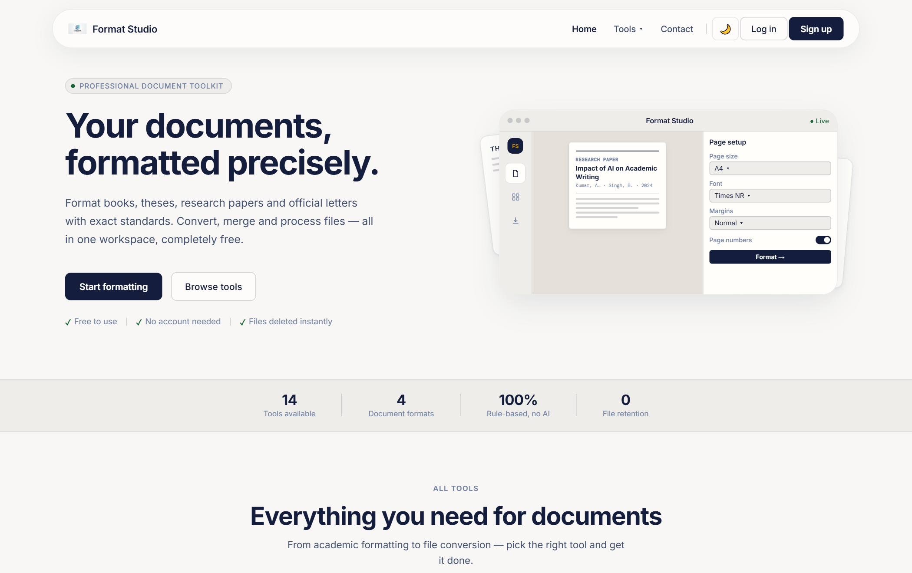
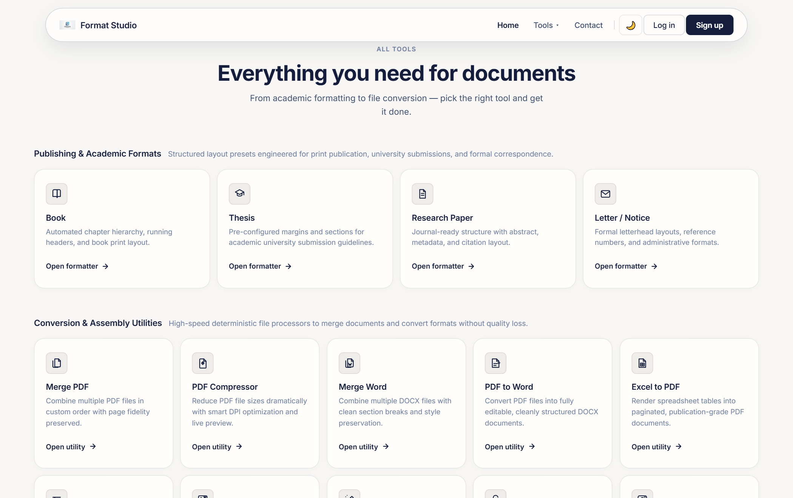
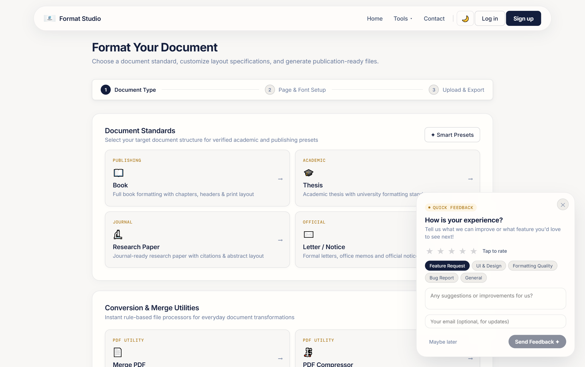
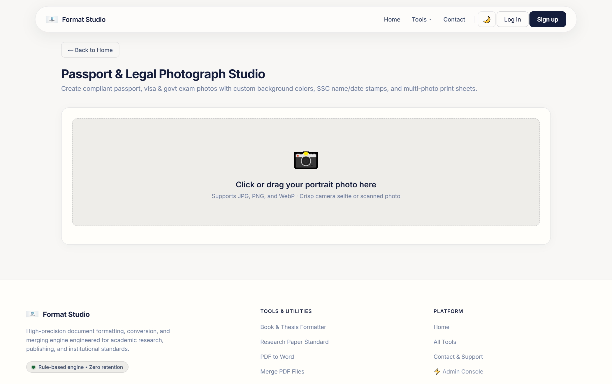
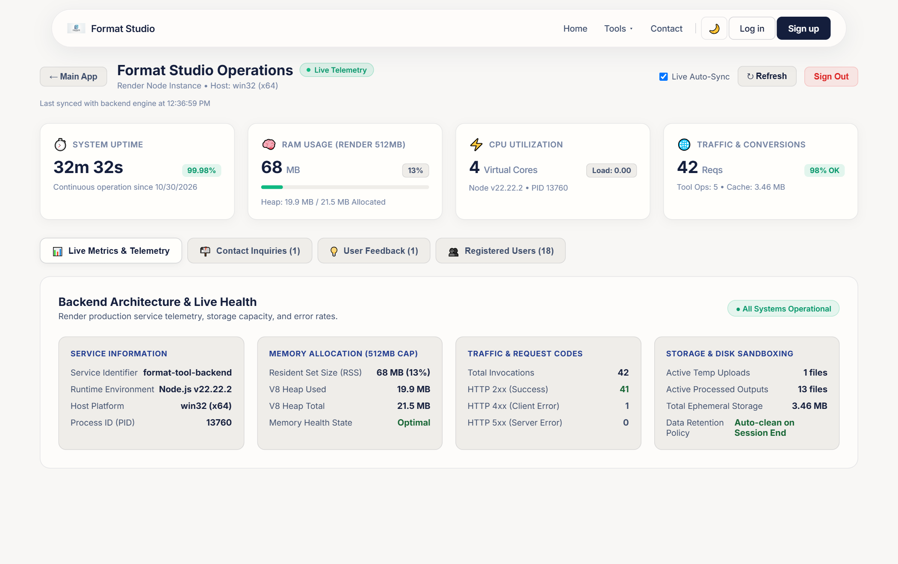
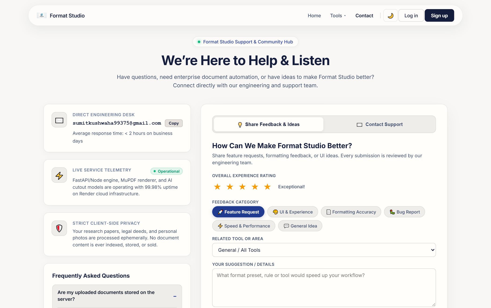

<div align="center">

  

  # Format Studio

  **Professional Document Formatting, File Conversion & Legal Studio**

  [](https://formatting-tool-frontend.onrender.com)
  [](https://react.dev)
  [](https://nodejs.org)
  [](https://python.org)
  [](https://supabase.com)
  [](LICENSE)

  <p align="center">
    Format academic theses, research papers, and books to exact print standards. Convert, compress, unlock, and edit documents with deterministic engines — complete with an AI-powered Passport & Legal Photo studio and a real-time admin telemetry dashboard.
  </p>

  <p align="center">
    <a href="https://formatting-tool-frontend.onrender.com"><strong>Explore Live Demo »</strong></a>
    ·
    <a href="#quick-start">Quick Start</a>
    ·
    <a href="#core-features">Features</a>
    ·
    <a href="#architecture">Architecture</a>
    ·
    <a href="#admin-portal--telemetry">Admin Console</a>
  </p>

</div>

---

## Preview

<div align="center">
  
</div>

---

## Why Format Studio?

Most online document tools are either bloated with paywalls, upload limits, or send private documents to untrusted third-party servers. Format Studio was built from the ground up to solve these pain points:

- **Zero Document Retention**: Files are processed in ephemeral sandbox directories and scrubbed immediately after generation.
- **Rule-Based Academic Precision**: Generates publication-grade `.docx` files matching strict university and journal guidelines (margins, font hierarchies, line spacing, running headers).
- **Lightweight & Render-Optimized**: Custom-tuned Python backend that comfortably runs within Render's free tier (512MB RAM cap) using downsampled inference and native C++ PDF bindings (`PyMuPDF`).
- **Zero-Latency Card Rendering**: 60 FPS client navigation with hardware-accelerated GPU layer promotion, instant font preconnecting, and zero layout thrashing.

---

## Core Features

<div align="center">
  
</div>

### 1. Academic & Publishing Formatter
*Automated structural layouts for publication, university submissions, and formal correspondence.*
- **Books**: Running headers, alternate page numbering, chapter page breaks, and standard book trim margins.
- **Theses**: University-compliant margins (1.5" left gutter for binding), APA/MLA heading hierarchies.
- **Research Papers**: Double-column structures, abstract blocks, metadata header, and citation sections.
- **Letters & Notices**: Formal executive letterhead layouts with reference number grids.

<div align="center">
  
</div>

### 2. High-Speed Conversion & File Utilities
*Deterministic file processors running native Python and C++ bindings:*
- **PDF to Word**: Converts complex PDF files into editable, cleanly structured `.docx` files.
- **Merge PDF & Merge Word**: Combine multiple PDFs or Word documents with clean page separation.
- **PDF & Image Compressor**: Smart DPI downsampling and adaptive image quantization with live before/after size estimation.
- **Hindi to KrutiDev 010**: Bi-directional conversion between modern Unicode Hindi and legacy KrutiDev font encoding.
- **Unlock PDF**: Fast removal of user passwords and permissions restrictions on protected PDFs.
- **Excel to PDF**: Tabular rendering of `.xlsx` spreadsheets into publication-grade paginated PDFs.

---

### 3. Passport & Legal Photograph Studio
*All-in-one studio for job applications, passports, visas, and government exam portals.*

<div align="center">
  
</div>

- **AI Background Removal**: Connected directly to an optimized `u2netp` deep-learning model (4.5MB vs 176MB standard model) that cuts out backgrounds in ~3.2 seconds without exceeding memory limits.
- **One-Click Studio Swatches**: Instant background replacement with white, sky blue, grey, off-white, or navy colors.
- **Standard Aspect Presets**:
  - *India Passport / PAN / DL* (35 × 45 mm, 7:9 aspect)
  - *US Visa / Green Card* (51 × 51 mm, 1:1 square)
  - *Govt Exams (SSC / UPSC / Police)* (35 × 45 mm)
  - *Schengen Visa & Stamp Size* (25 × 30 mm)
- **Govt Exam Name & Date Stamps**: Add official applicant name and photograph capture date stamps directly to the lower banner.
- **Multi-Photo Print Sheets**: Auto-arrange 4, 6, 8, or 12 copies on standard 4×6" or A4 photo sheets with dashed cutting guidelines.

---

### 4. Admin Portal & Telemetry Console
*A dedicated operations dashboard with real-time server vitals modeled after the Render console.*

<div align="center">
  
</div>

- **Live Server Metrics**: Real-time Node.js uptime, CPU load averages, and memory gauge tracked directly against the Render 512MB RAM threshold.
- **Traffic Counters**: Total processed requests, active sessions, and file cache storage usage.
- **Inquiry Management**: View, mark as read, and manage contact messages with priority badges.
- **User Directory**: View registered Supabase users, current subscription plans, and document conversion history.
- **Secure Access**: Session-based admin token authentication backed by environment variables.

---

### 5. Bento-Grid Support & Feedback Hub
*Modern communication center designed for fast resolution and community feedback.*

<div align="center">
  
</div>

- Direct 1-click clipboard desk connected to `sumitkushwaha99375@gmail.com`.
- Priority-tagged ticket submission (`Normal`, `Urgent`, `Critical`).
- Interactive FAQ accordion for common institutional and conversion questions.
- Star-rating feedback pipeline with automated local JSON persistence and Supabase synchronization.

---

## Architecture & Tech Stack

```
Format_Tool/
├── client/                     # Frontend SPA (React 18 + Vite)
│   ├── public/                 # Static assets, favicon, _redirects (Render SPA)
│   ├── src/
│   │   ├── components/         # Nav, Footer, Modals, Daily Feedback, Workspaces
│   │   ├── hooks/              # useAuth, useTheme
│   │   ├── pages/              # Home, Tool, Admin, Contact, Pricing, Dashboard
│   │   │   └── tools/          # Individual tool studios (LegalPhoto, MergePDF, etc.)
│   │   └── styles/             # globals.css (Hardware-accelerated CSS surfaces)
│   └── vite.config.js          # API proxy and chunk optimization
│
├── server/                     # Backend API (Node.js + Express)
│   ├── index.js                # Server entry point, telemetry middleware, routes
│   ├── adminStore.js           # Admin sessions, metric collector, message store
│   ├── accessControl.js        # Auth guards and Supabase user verifications
│   ├── fileValidation.js       # MIME type checks, size bounds, sanitized logging
│   ├── converter.py            # Python processing engine (PyMuPDF, python-docx)
│   └── test/                   # Automated unit test suites (TAP runner)
│
├── docs/screenshots/           # High-resolution documentation images
└── render.yaml                 # Blueprint for zero-downtime Render deployment
```

### Stack Breakdown

| Layer | Technologies | Key Responsibilities |
|---|---|---|
| **Frontend** | React 18, Vite, Canvas API | 60 FPS transitions, interactive crop & zoom canvas, zero-latency navigation |
| **Backend** | Node.js, Express, Multer | Rate limiting, telemetry collection, Supabase integration, file lifecycle |
| **Engines** | Python 3.10+, PyMuPDF, python-docx, rembg (`u2netp`) | Deterministic document parsing, text transcoding, fast AI background cutout |
| **Database & Auth** | Supabase (PostgreSQL + GoTrue) | User profiles, document counters, secure JWT session management |


---

## Quick Start

### Prerequisites
- **Node.js** (v18.0 or higher)
- **Python** (v3.10 or higher)
- **Git**

### 1. Clone & Setup Repository
```bash
git clone https://github.com/Sumit-Kushwaha62/formatting_tool.git
cd formatting_tool
```

### 2. Configure Backend
```bash
cd server
npm install

# Install Python processing dependencies
pip install -r requirements.txt
```

Create `server/.env`:
```env
PORT=5000
PYTHON_CMD=python
ADMIN_PASSWORD=your_secure_admin_passcode
CONTACT_EMAIL=sumitkushwaha99375@gmail.com

# Supabase Configuration
SUPABASE_URL=https://your-project.supabase.co
SUPABASE_SERVICE_KEY=your_supabase_service_role_key


```

Start the backend server:
```bash
npm start
# Server running on port 5000
```

### 3. Configure Frontend
In a new terminal:
```bash
cd client
npm install
```

Create `client/.env`:
```env
VITE_API_URL=http://localhost:5000
VITE_SUPABASE_URL=https://your-project.supabase.co
VITE_SUPABASE_ANON_KEY=your_supabase_anon_key
VITE_SITE_URL=http://localhost:5173
```

Start Vite dev server:
```bash
npm run dev
# Running at http://localhost:5173
```

---

## Running Automated Tests

The backend includes comprehensive test suites covering access control, file boundary sanitization, and payment feature gates:

```bash
# Run access control & security tests
node server/test/accessControl.test.js

# Run file validation & MIME sanitizer tests
cd server && node test/fileValidation.test.js

# Run monetization gate tests
node server/test/monetization.test.js
```

---


## Security & Privacy Policy

- **No Data Mining**: User documents are strictly processed for formatting and immediately unlinked.
- **Sanitized Logs**: All error loggers redact authentication headers, bearer tokens, file paths, and email addresses.
- **Boundary Checks**: Strict MIME type validation rejects deceptive or malformed file extensions before passing them to Python processors.

---

## Contact & Support

Developed by **Sumit Kushwaha**  
- **Email**: [sumitkushwaha99375@gmail.com](mailto:sumitkushwaha99375@gmail.com)  
- **Live Application**: [format Studio](https://formatting-tool-frontend.onrender.com)  
- **GitHub**: [@Sumit-Kushwaha62](https://github.com/Sumit-Kushwaha62)

Feel free to open an issue or submit a pull request if you have feature suggestions or layout presets you'd like added!
